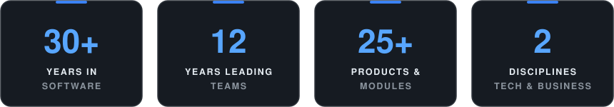
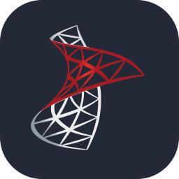
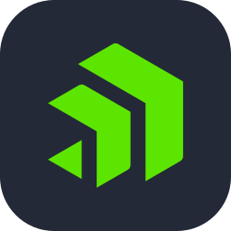

# Yusuf Kamhi

### Software Project Manager · Technical Team Lead · AI-Augmented SDLC

I take enterprise software from requirement to production, and I still write code on the hardest problems. 
30+ years in software, 12 of them leading delivery and engineering teams, most of it in logistics & customs technology.

 

 

---

## 📊 At a Glance

---

## ⚡ What I Do

I sit between **engineering and business**: scoping, architecture, team building, Agile execution, release and support. I grew from the code up, from support and development to technical lead, before moving into delivery leadership. I still write code on the hardest problems, review designs and set engineering standards.

* 🚀 **End-to-end delivery**: scope, estimation, planning, risk, releases, go-lives and customer escalations
* 💻 **Hands-on technical lead**: request analysis, technical specifications, coding the most complex parts myself
* 👥 **Team leadership**: developers, analysts and testers across parallel projects; hiring, mentoring and 1:1 coaching
* 🧱 **Engineering quality**: architecture and coding standards, code reviews, Scrum, TDD and CI/CD in daily delivery
* 🤖 **AI-driven engineering**: AI agents across the whole workflow, with human-in-the-loop checkpoints at key decisions
* 🔗 **Integration**: REST, SOAP, EDI, XML, banking (MT940), ERP and global trade networks
* 🚢 **Customs & logistics domain**: customs clearance, transit (NCTS), e-Manifest, bonded warehouse, e-Invoicing

---

## 💼 Experience

**WiseTech Global** · Software Project Manager & Technical Team Lead · *2018 – 2026* 
Owned 2 parallel projects and led a 6-person team of developers, analysts and testers, delivering customs modules: Customs Declaration, Summary Declaration, e-Birlik (exporters' associations), eCommerce, NCTS Transit, Global Manifest and e-Trade. Key project: the Customs Declaration & Global Manifest integration linking Turkish customs to CargoWise. Bridged the 2018 acquisition of Ulukom into WiseTech's global product line.

**Ulukom** · Software Project Manager · *2014 – 2018* 
Turkey's customs & logistics software provider serving 800 customers. Built and led an 8-person development team across 7–8 parallel projects. Ran two TÜBİTAK-TEYDEB 1507 projects (Agent-Based BPM for Ship Agencies; Vehicle Routing & Shipment Planning) plus KOSGEB-funded R&D at İTÜ Technopark, all completed successfully. Delivered a cloud-based 3PL logistics management system and led the migration from Progress OpenEdge to a multi-UI low-code platform.

**Ulukom** · Developer → Senior Software Engineer · *1998 – 2014* 
Technical lead for e-Invoice / e-Archive / e-Ledger web services, NCTS transit and express cargo customs declarations; built integrations with INTTRA, Traxon, E-AWB, EurTradeNet, Logo and Univera ERP. On-site at Peugeot Turkey HQ (2002 – 2006) leading localization projects.

---

## 🤖 AI in Software Delivery

From TÜBİTAK-funded **agent-based R&D** to **multi-agent AI workflows** in production delivery. I use AI across the whole workflow, not only as an autocomplete:

**Issue definition → Analysis → Specification → Architecture → Coding → Code review → Testing → Documentation → Delivery**

`GitHub Copilot` · `Claude` · `GPT` · `Gemini` · `Multi-agent workflows` · `AI code review` · `Human-in-the-loop`

> **The goal: more engineering leverage, with humans in control of quality, architecture and maintainability.**

---

## 🛠️ Technology

  

---

## 🎓 Education & Expert Roles

* **MSc**, Computer & Information Engineering, Sakarya University
* **MBA**, İstanbul University
* Bachelor's degrees in Management Information Systems, Business Administration and Philosophy; associate degrees in Computer Programming and Information Management
* **TÜBİTAK-TEYDEB**: Business Development Mentor, selected and assigned in the BİGG+ program *(2020 – present)*
* **European Commission**: Registered External Expert, Horizon 2020 expert database *(2014 – present)*
* **İstanbul Justice Commission**: Registered IT Expert Witness (Bilirkişi) *(2013)*

---

## 📌 Areas of Interest

`AI Engineering` · `Software Architecture` · `Engineering Leadership` · `Digital Transformation`

`Enterprise Integration` · `Legacy Modernization` · `Logistics Technology` · `Customs Systems`

---

### Open to software leadership roles and advisory engagements.

🇹🇷 Turkish (native) · 🇬🇧 English (professional) · 🇪🇸 Spanish (elementary)

 

